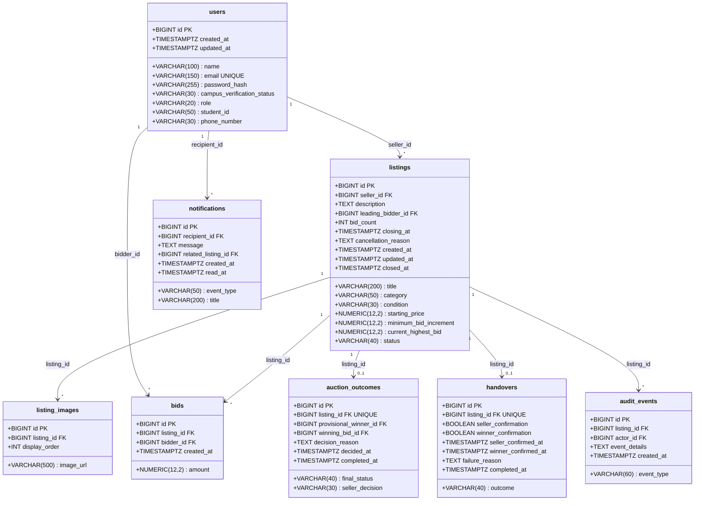

# Database Schema Diagram & Physical Architecture

This document outlines the physical database schema, data types, constraints, index optimization, and concurrency locking mechanisms implemented in PostgreSQL 17.

---

## 1. Physical Table Layout & Data Types



---

## 2. High-Performance Index Specifications

PostgreSQL composite and targeted B-Tree indexes are defined in `V1__initial_schema.sql` to optimize query latency and prevent full table scans under high concurrent traffic:

| Index Name | Target Table | Target Columns | Primary Purpose |
|---|---|---|---|
| `idx_listings_status_closing` | `listings` | `(status, closing_at)` | **Scheduler Optimization**: Accelerates `closeExpiredAuctions()` query `WHERE status = 'OPEN' AND closing_at <= NOW()`. |
| `idx_listings_seller` | `listings` | `(seller_id)` | **Student Activity**: Fast lookup of listings created by the authenticated student. |
| `idx_listings_category` | `listings` | `(category)` | **Marketplace Filtering**: Category tabs and faceted filtering. |
| `idx_listings_condition` | `listings` | `(condition)` | **Marketplace Filtering**: Filtering items by condition (New, Like New, Good, etc.). |
| `idx_listings_current_price`| `listings` | `(current_highest_bid)` | **Price Sorting**: Accelerates price range and sort order queries. |
| `idx_bids_listing` | `bids` | `(listing_id, created_at DESC)` | **Bid History Table**: Rapid retrieval of chronological bids for auction details page. |
| `idx_bids_bidder` | `bids` | `(bidder_id)` | **My Bids Activity**: Rapid lookup of all auctions where user has active bids. |
| `idx_notifications_recipient`| `notifications` | `(recipient_id, read_at)` | **Unread Notification Bell**: Instant count and fetching of unread student notifications. |
| `idx_audit_listing` | `audit_events` | `(listing_id)` | **Audit History**: Administrative and compliance tracking per auction item. |

---

## 3. Concurrency Protection & Row-Level Locking

To guarantee fair bidding under simultaneous requests:

```sql
-- Executed inside @Transactional(isolation = Isolation.READ_COMMITTED)
SELECT * FROM listings 
WHERE id = :listingId 
FOR UPDATE; -- PESSIMISTIC_WRITE lock prevents lost updates
```

1. **Transaction A** acquires the exclusive lock on `listing_id = 4`.
2. **Transaction B** attempting to bid simultaneously on `listing_id = 4` blocks safely until Transaction A commits or rolls back.
3. Transaction B re-reads the updated, committed `current_highest_bid` directly from PostgreSQL and evaluates the increment rule against real data.
