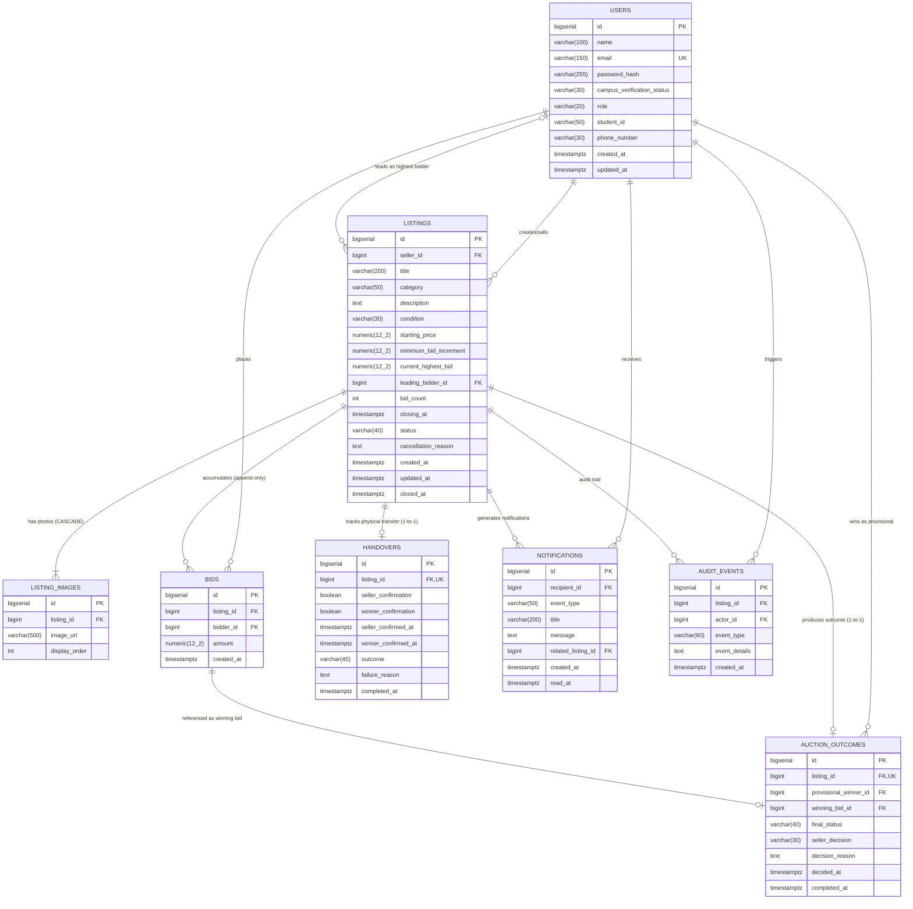

# Entity-Relationship (ER) Diagram — Campus Auction Platform

This document details the relational data model for the **Campus Auction Platform**, representing entity relationships, foreign keys, and cardinalities.

---

## 1. Complete ER Diagram

---

## 2. Cardinality and Structural Integrity Rules

| Parent Entity | Relationship | Child Entity | Cardinality | Deletion / Mutation Rule |
|---|---|---|---|---|
| `USERS` | Sells | `LISTINGS` | $1 : N$ | Restricted: Seller account cannot be deleted while active auctions exist. |
| `USERS` | Places | `BIDS` | $1 : N$ | Append-only: User cannot delete submitted bids. |
| `LISTINGS` | Owns | `LISTING_IMAGES` | $1 : N$ | Cascade Delete: Removing draft listing purges image metadata references. |
| `LISTINGS` | Receives | `BIDS` | $1 : N$ | Append-only: Bids are preserved permanently even after auction closure or cancellation. |
| `LISTINGS` | Outcome | `AUCTION_OUTCOMES` | $1 : 0..1$ | Unique constraint: Exactly one outcome row per closed auction. |
| `LISTINGS` | Handover | `HANDOVERS` | $1 : 0..1$ | Unique constraint: Exactly one handover lifecycle per reserved auction. |
| `USERS` | Receives | `NOTIFICATIONS` | $1 : N$ | Private: Visible and accessible strictly by `recipient_id`. |
| `LISTINGS` | Audited by | `AUDIT_EVENTS` | $1 : N$ | Immutable log: Historical trail of creation, bids, closures, and cancellations. |

---

## 3. Decimal-Safe Representation
- All monetary columns (`starting_price`, `minimum_bid_increment`, `current_highest_bid`, `amount`) are modeled as `NUMERIC(12, 2)`.
- Never floating-point: prevents IEEE 754 precision inaccuracies during increments and comparisons.
