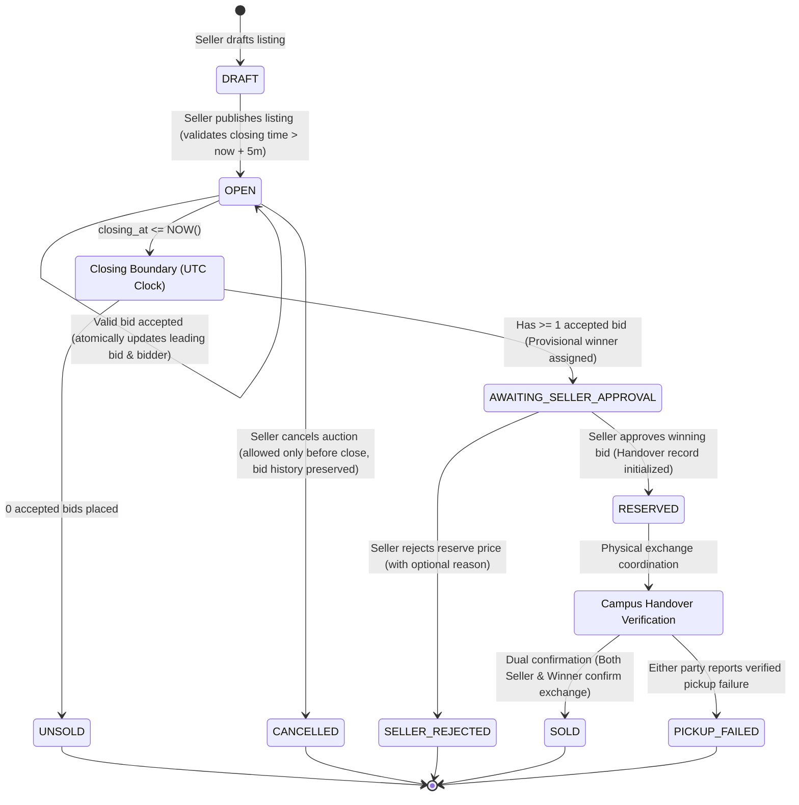
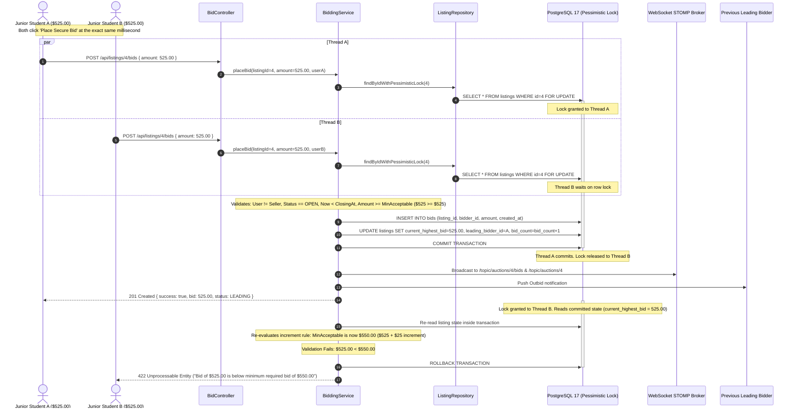
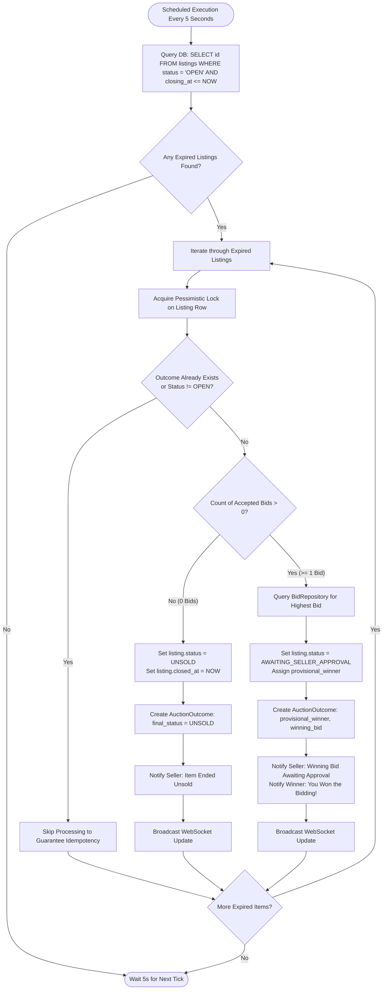
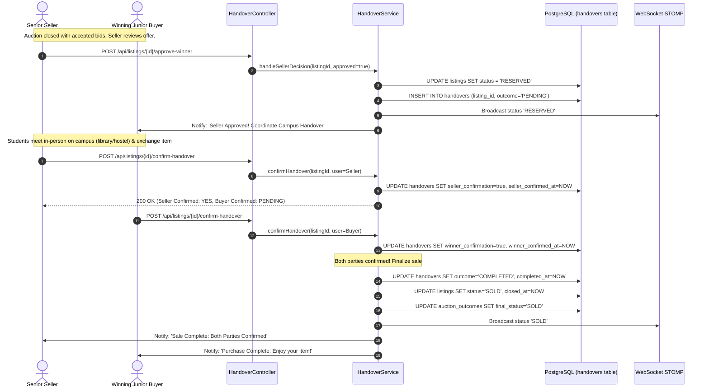

# Workflow & State Machine Diagrams — Campus Auction Platform

This document models the business logic, state machines, concurrency handling, and interaction flows across the **Campus Auction Platform**.

---

## 1. Auction Lifecycle State Machine

The auction lifecycle is modeled as a deterministic finite-state machine to prevent invalid status transitions and race conditions:

---

## 2. Concurrent Bidding Engine Sequence Diagram

Demonstrating how two students (Bidder A and Bidder B) submitting simultaneous bids are serialized cleanly without lost updates or race conditions:

---

## 3. Automated Auction Closing Engine Flow

Independent background process evaluating auctions strictly by authoritative server timestamps:

---

## 4. Campus Handover Dual-Confirmation Flow

